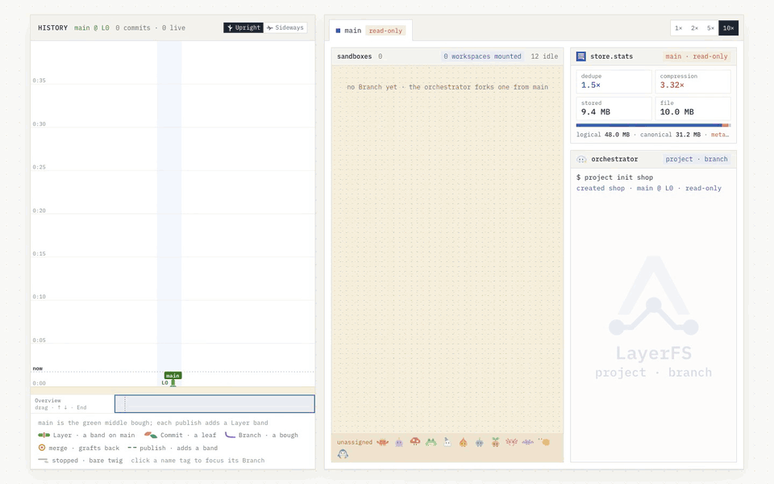

<p align="center">
  
</p>

<h1 align="center">LayerFS</h1>

<p align="center"><strong>Ephemeral Workspaces. Durable Shared History.</strong></p>

<p align="center">
  LayerFS is the substrate under your agents. Each one mounts a complete, writable
  Workspace over shared committed history, does its work, commits what it changed,
  and goes away.
</p>

<p align="center">
  <a href="LICENSE"></a>
  <a href="docs/release-notes/0.1.7/README.md"></a>
</p>

> **Status:** LayerFS 0.1.7 Developer Preview, released as source. It is for
> evaluation and agent-runtime integration, not production storage: there is no
> crash or power-loss durability. Read the [release record](docs/release-notes/0.1.7/README.md)
> and its waivers before relying on it.

## Core ideas

<table>
  <tr>
    <td width="33%" valign="top">
      <br>
       <b>01 · Ephemeral Computing</b><br>
      Compute exists only while a command runs.
    </td>
    <td width="33%" valign="top">
      <br>
       <b>02 · Decentralized Agents</b><br>
      Agents on different computers share one serverless Store.
    </td>
    <td width="33%" valign="top">
      <br>
       <b>03 · Multiagent Coordination</b><br>
      One project, many Branches. One Branch, many agents.
    </td>
  </tr>
  <tr>
    <td width="33%" valign="top">
      <br>
       <b>04 · Recursive Filesystem</b><br>
      Fork recursively any Commit, at any depth.
    </td>
    <td width="33%" valign="top">
      <br>
       <b>05 · Ultra Storage Optimization</b><br>
      10 copies compress into 0.31.
    </td>
    <td width="33%" valign="top">
      <br>
       <b>06 · Instant Bootstrap</b><br>
      Dependencies come with every mount. No time lost reinstalling.
    </td>
  </tr>
</table>

**And underneath them**

| | Supporting idea | In one line |
| --- | --- | --- |
|  | **07 · Auto Checkpoints** | Every step an agent takes is a checkpoint to return to. |
|  | **08 · Append-only Objects** | Saved objects are never rewritten. The Store only grows. |
|  | **09 · Conflict Rules (`.lww`)** | Name the files that should never conflict. The newest edit wins. |
|  | **10 · Big File, Small Edit** | An edit costs the size of the edit, not the size of the file. |

## See it run

<p align="center">
  
</p>
<p align="center"><sub>Agents fork Branches, work in Workspaces inside Sandboxes, commit, merge and publish to <code>main</code>. The history grows as they go.</sub></p>

## Get started

Paste this into your coding agent. It sets LayerFS up and works on a Branch of its own:

```text
Set up LayerFS for this project and start using it for your work.

1. Read the setup guide in https://github.com/Ephemeral-AI-Lab/layerfs: sdk/js/README.md explains the JavaScript SDK, its native binding, the Linux daemon and the environment it reads (LAYERFS_HOME, LAYERFS_DOCKER, LAYERFS_IMAGE, LAYERFS_VOLUME, LAYERFS_DAEMON).
2. Check the requirements before you start: a Linux host, Docker Engine, Node 20 or newer, and a local ext4, xfs or btrfs filesystem for the Store. If one is missing, stop and tell me which.
3. Build what the guide says to build and set those variables.
4. Run project.init once on this repository. It captures the whole tree, ignored files included, as main @ L0.
5. Fork a Branch for your work. From now on, use sdk.fs for file reads and edits, and for each Bash command mount a Workspace on your Branch, exec, commit, then unmount.
6. Check it worked: write a file on your Branch and confirm list_commits shows the Commit.

Report what you ran and what each step returned. If a step fails, stop and give me the exact error; don't retry it on your own.
```

To set it up by hand, follow the [JavaScript SDK guide](sdk/js/README.md).

## Works with

- **LayerFS × [DSH](dsh/README.md)** (preview): agents in a DeepSeek Harness session fork, test, merge and
  publish from bash, and a LayerFS tab draws what each one did.
- **LayerFS × Pi**: planned.

## Learn more

| | |
| --- | --- |
| The 0.1.7 manual | [Manual](docs/versioned/0.1.7/README.md) · [SDK and terminal UI](docs/versioned/0.1.7/sdk-and-ui.md) · [SDK reference](docs/versioned/0.1.7/sdk-reference.md) |
| Concepts | [Core concepts](docs/general/concepts.md) · [Documentation index](docs/README.md) |
| Release and limits | [0.1.7 release record](docs/release-notes/0.1.7/README.md) · [Known limits](docs/versioned/0.1.7/sdk-and-ui.md#7-known-limits) |
| Benchmarks | Released fs-bench-pro results: [v0.1.4](docs/release-notes/0.1.4/benchmark-closeout.md) · [v0.1.5](docs/release-notes/0.1.5/benchmark-closeout.md) · [v0.1.6](docs/release-notes/0.1.6/benchmark-closeout.md) (0.1.7 published none) |

## License

LayerFS is licensed under the [MIT License](LICENSE).
